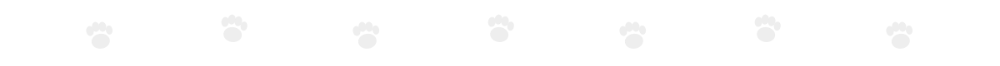

<!-- 🐈‍⬛ preto no branco, código de madrugada -->

 

## 🐈‍⬛ sobre

desenvolvedor autônomo. construo ferramenta que resolve de verdade — de um baixador
de música a uma ponte que deixa a IA (Claude, ChatGPT, Gemini) operar o PC pelo chat:
um agente de um arquivo só, zero dependências, com lixeira com desfazer e trava
anticatástrofe rodando na sua máquina. de dia eu escrevo código; de madrugada o gato revisa.

- 🔭 **no forno**: [`ponte-local`](https://github.com/micsxnn/ponte-local) — sua IA opera seu PC, sem porta aberta, sem VPN
- ✍️ **escrevo em**: [thesoft.vercel.app](https://thesoft.vercel.app)
- ⚡ **fato**: o banner deste perfil foi desenhado à mão em SVG animado — o gato aprova

   
  
  
  
  
  
  
    
  
  

## 📊 números

  
  

## 🕹️ o que eu ando construindo

  
  
   
  
  

  

## 🐍 a cobrinha come meus commits

  <picture>
    <source media="(prefers-color-scheme: dark)" srcset="https://raw.githubusercontent.com/micsxnn/micsxnn/output/github-contribution-grid-snake-dark.svg"/>
    <source media="(prefers-color-scheme: light)" srcset="https://raw.githubusercontent.com/micsxnn/micsxnn/output/github-contribution-grid-snake.svg"/>
    
  </picture>

  
   
  <em>— cada commit aqui foi supervisionado por um gato preto 🐈‍⬛ —</em>

