<!-- micaelsan — perfil profissional -->

 

## sobre

Desenvolvedor autônomo. Construo ferramentas que resolvem problemas reais — de um
baixador de música a uma ponte de operação remota de PC via chat: agente de um
arquivo só, zero dependências, fila offline, lixeira com desfazer e trava
anticatástrofe. Foco em software local, leve e verificável.

- **em destaque**: [`ponte-local`](https://github.com/micsxnn/ponte-local) — operação remota de PC pelo chat, de qualquer lugar, sem porta aberta, sem VPN
- **publicação**: [thesoft.vercel.app](https://thesoft.vercel.app)

   
  
  
  
  
  
  
    
  
  

## estatísticas

  
  

## projetos

  
  
   
  
  

## atividade de commits

  

  

